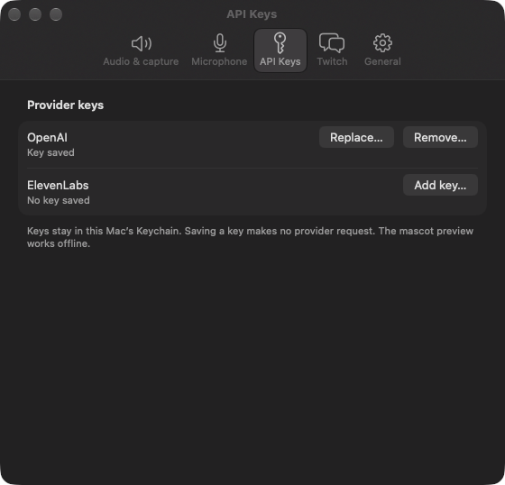

1. Create a dedicated project key in your [OpenAI API dashboard](https://platform.openai.com/api-keys). Keep the key private.
2. In the native app, open **Settings > API Keys**. Choose **Add key…** beside OpenAI, paste the key and choose **Save key**.
3. Look for **Key saved**. EchoPaw keeps it in this Mac’s Keychain. Saving it does not check model access, generate text or incur API usage.

Use **Replace…** to save a new key or **Remove…** to delete the local copy. To invalidate a key everywhere, revoke it in the OpenAI dashboard. Cloud dialogue, moderation and model selection are pending. [OpenAI key guide](https://developers.openai.com/api/docs/guides/api-keys)
